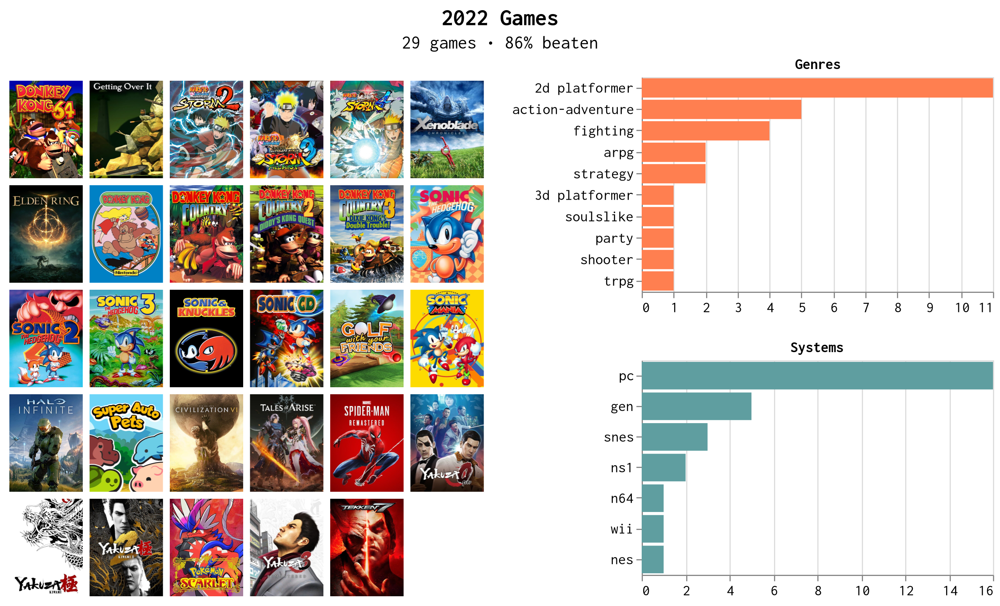
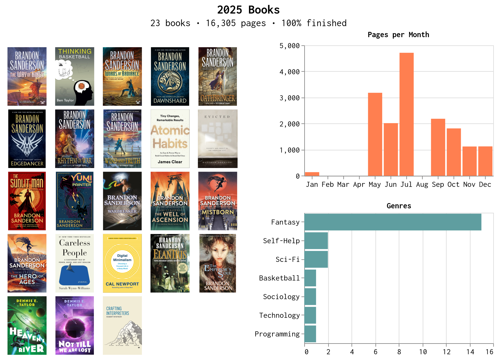

# Media Wrapped

Turns logs of the media I've consumed into a yearly recap image: the covers next to a few charts.

## Setup

```sh
npm install
```

## Games



Covers come from [IGDB](https://www.igdb.com/). Add IGDB credentials to a `.env` file:

```sh
IGDB_CLIENT_ID=...
IGDB_CLIENT_SECRET=...
```

The CSV needs these columns, where `id` is the game's IGDB id:

```csv
id,title,genre,system,purchaseMethod,completed,yearPlayed
27238,am2r: return of samus,metroidvania,pc,free,true,2019
```

```sh
npm run games -- path/to/games.csv --year 2023
```

The image is written to `games.png`.

## Books



Books are read straight from a [Calibre](https://calibre-ebook.com/) library's `metadata.db`, opened read-only. Covers come from the library's own `cover.jpg` files, and genres come from each book's tags.

The library needs these custom columns:

| Column            | Type                                      | Holds                                                 |
| ----------------- | ----------------------------------------- | ----------------------------------------------------- |
| `custom_column_1` | Integers                                  | page count                                            |
| `custom_column_3` | Date                                      | date finished                                         |
| `custom_column_6` | Fixed text, shown as a list (enumeration) | status: `backlog`, `dnf`, `finished` or `in-progress` |

Only books with a status of `finished` or `dnf` are included. Calibre numbers custom columns in the order they were created, so if yours have different numbers, update the query in `src/books/db.ts`.

```sh
npm run books -- path/to/calibre/metadata.db --year 2025
```

The image is written to `books.png`.
